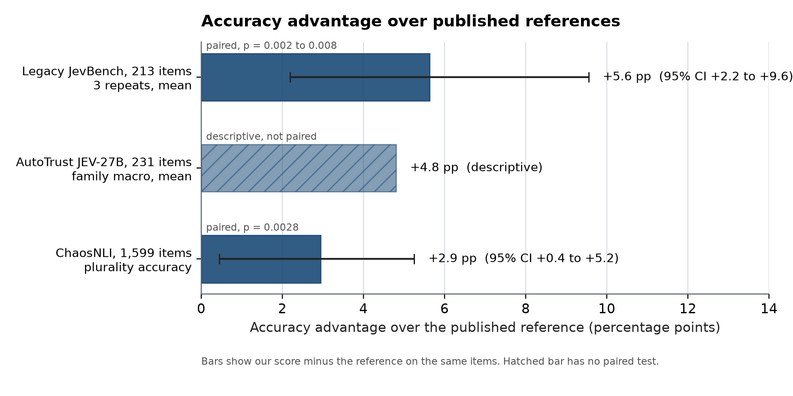
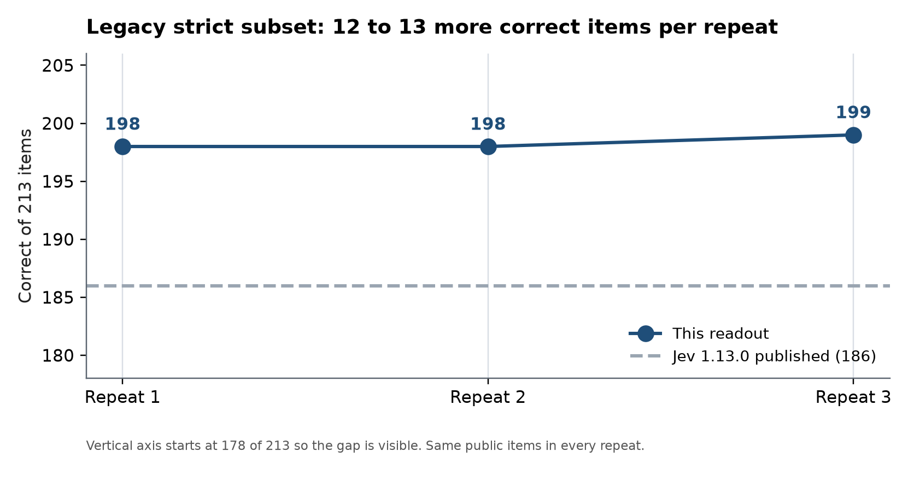
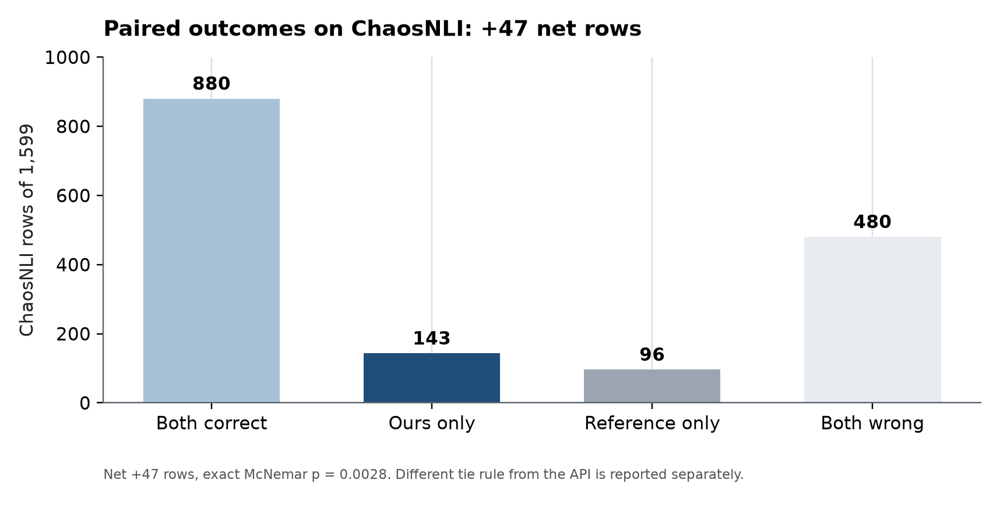
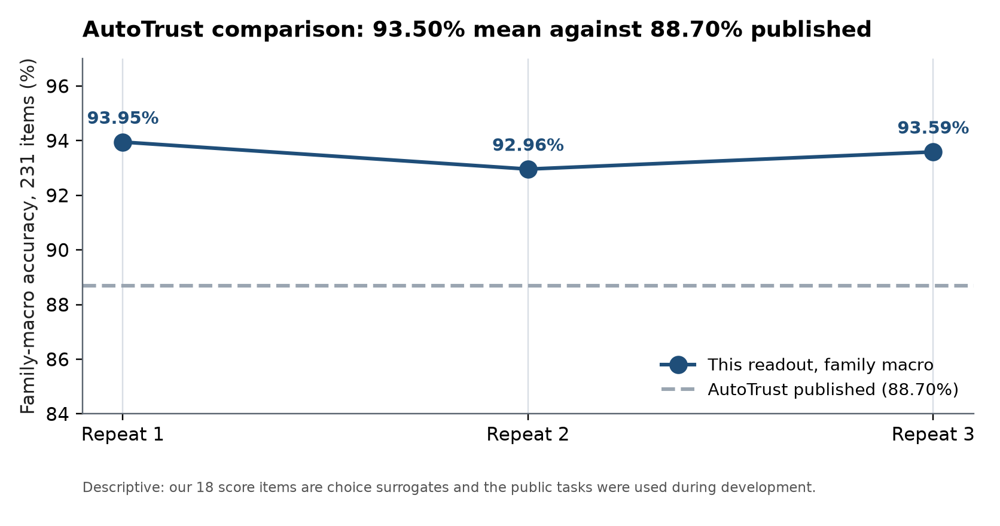
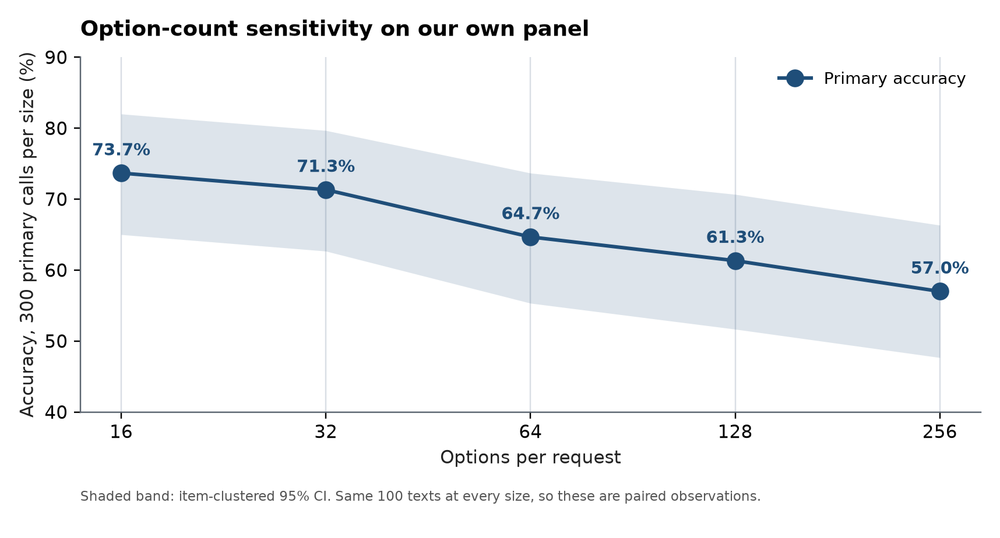

# Benchmark results

All results below are from 20 October 2026 and come from the maintainer-host production
deployment of this package: unchanged base weights, the B0 readout, the patched vLLM runner and
the typed gateway. The choice lanes cover 2 to 16 options (lettered path) and, on the wide
scaling panel, 32 to 256 options (wide-label path). No speed, latency or throughput figures are
reported anywhere in this document.

## Results at a glance



Paired comparisons on the same items. Legacy JevBench and ChaosNLI carry exact McNemar tests; the AutoTrust bar is a descriptive re-aggregation because their per-item outputs are not public.



The unchanged base answers 12 to 13 more of the 213 public legacy items than the published Jev 1.13.0 output in every repeat.



On the 1,599 ChaosNLI rows, 143 are correct here and wrong in the published reference, against 96 the other way.



Family-macro accuracy on the public 231-item set, recomputed for all three repeats. The comparison is descriptive, not a controlled head-to-head.

## Legacy panel: 3,300 measured calls

This panel was measured against the production deployment. 3,300 calls were scheduled; 16 calls
failed and are counted as wrong with no probability. Nothing was retried and no rows were
excluded, per the frozen no-retry rule. Requests were sent one at a time.

The panel has two parts. The first asks 567 items three times: the 213 strict legacy tasks, the
18 score tasks as a choice surrogate, 240 DMUP items (200 primary items and 40 with shuffled
option order) and 96 ChaosNLI items. The second asks all 1,599 ChaosNLI test rows once. The 96
repeated ChaosNLI items are among those 1,599 rows and are never counted as extra unique items.

Accuracy uses the frozen benchmark rule: highest probability, with exact ties broken by option
key name. The live API breaks exact ties by the order of options in the request. Both rules are
reported.

| Lane | Items | Repeat 1 | Repeat 2 | Repeat 3 | Reference |
|---|---:|---:|---:|---:|---|
| Legacy strict | 213 | 198 | 198 | 199 | Jev 1.13.0 published: 186 |
| Legacy score, choice surrogate | 18 | 16 | 15 | 16 | Jev 1.13.0 published: 14, native score |
| DMUP primary | 200 | 176 | 178 | 176 | Saved Jev measurement, see below |
| DMUP shuffled controls | 40 | 20 | 35 | 36 | Saved Jev measurement, see below |
| ChaosNLI subset | 96 | 65 | 65 | 65 | Published plurality accuracy: 62 |

| Lane | Items | This package | Jev 1.13.0 published |
|---|---:|---:|---:|
| ChaosNLI, all test rows once | 1,599 | 1,028 (64.29%) | 981 (61.35%) |

Under the live API request-order tie rule the same rows score: legacy strict 196, 198, 199 and
full ChaosNLI 1,027 (p = 0.0032). Exact ties are rare but real; both sets of counts are in
[`summary.json`](../bench/expanded/summary.json).

## The 16 failed calls

All 16 failures are consecutive DMUP shuffled-control calls in repeat 1 (HTTP 502, gateway 30 s
engine socket timeout). The engine log for that window shows one running and one waiting request
for about eight minutes followed by a large prefill; the remote origin of the long request was
not identified, and no causal attribution to any external client is asserted. The failures are
counted as wrong in every denominator above and have no probabilities.

## Paired comparisons

Paired comparisons use the exact two-sided McNemar test on the same items:

- Legacy strict against published Jev 1.13.0: p = 0.0075, 0.0075 and 0.0023 for the three
  repeats. The item-clustered bootstrap interval for the accuracy difference is +2.2 to
  +9.5 percentage points.
- All 1,599 ChaosNLI rows, frozen rule: this package answered 143 rows correctly that Jev
  missed, and Jev answered 96 that it missed (p = 0.0028). The item-bootstrap interval for the
  accuracy is 61.8% to 66.6%.
- ChaosNLI subset of 96: 65 correct in all three repeats against a published plurality accuracy
  of 62, p = 0.5078 in each repeat. This sample cannot separate the two systems.
- DMUP: the reference is a Jev 1.13.0 measurement of the same 240 items that we saved earlier
  with permission. It is not a published result, so its per-item outputs are not included here.
  None of the paired tests is significant (p from 0.061 to 0.302).
- DMUP shuffled controls: 3 of 24 valid pairs changed the chosen meaning in repeat 1;
  16 additional pairs were undefined because a call failed. Repeats 2 and 3 had 2 and 1 flips
  among 40 valid pairs each. Failed attempts still count wrong in accuracy denominators.

## Probability quality

Probability metrics use valid probability rows only, with denominators disclosed in
`summary.json`. Top-1 ECE with ten equal-width bins was 0.0489 on legacy strict, 0.0399 on DMUP,
0.0851 on the score surrogate and 0.2165 on the ChaosNLI subset (each lane pooled over its
repeats). ChaosNLI also has human vote distributions, and on them Jev's published probabilities
were closer than ours. Across all 1,599 rows the mean total variation distance from the votes
was 0.3618 for this package and 0.3321 for Jev (paired difference +0.0297, item-bootstrap
interval +0.0211 to +0.0381; Jev was closer on 910 rows, this package on 689). Our mean soft
Brier score was 0.3078. Higher plurality accuracy on ChaosNLI did not come with closer vote
distributions. Jev's published probabilities have two decimals, so small distance differences
carry some rounding error.

What these results do not show:

- Fresh generalization. Every item is public, and the legacy tasks were used during development.
- An official modern JevBench score. Jev was not run for this panel; the comparisons use
  published or previously saved outputs.
- That repeats are independent evidence. They measure run-to-run variation on the same items.
- Anything about option counts above 16 on this panel. This panel used option counts up to 16
  only; the wide scaling panel covers larger counts.

## Wide scaling panel: option sizes 16 to 256

This panel ran on the same production deployment with the wide-label lane enabled. It uses 100
real texts (25 each from CLINC, MTop, GoEmotions and DBpedia) from the published Decision
Models Under Pressure rq1 extension pools at revision `21820dc8b455e37aebaf5a83122233b6e564c109`.
Each text is asked at 16, 32, 64, 128 and 256 options, in the original option order and a second
permuted order, three repeats: 3,000 measured calls, 0 errors, 0 retries, 0 exclusions. 16
options use the lettered path; 32 to 256 use the wide-label path. Option count and
prompt/presentation change together at the 32-option boundary, so the scaling differences must
not be attributed to a single mechanism.

The same 100 texts are reused across option counts, orderings and repeats. The denominators
below are 300 (100 texts x 3 repeats) per option count, not 3,000 independent examples. Accuracy
uses the frozen benchmark rule (exact ties broken by option key name).

| Options | Primary correct/300 | Primary accuracy | Shuffled correct/300 |
|---:|---:|---:|---:|
| 16 | 221 | 73.67% | 223 |
| 32 | 214 | 71.33% | 207 |
| 64 | 194 | 64.67% | 207 |
| 128 | 184 | 61.33% | 193 |
| 256 | 171 | 57.00% | 178 |



Paired scaling of the same 300 primary items (exact two-sided McNemar, item-clustered
bootstrap):

- 256 vs 16 options: difference -16.67 points, clustered 95% CI [-26.00, -7.33],
  p = 1.41146684e-08.
- 32 vs 16: -2.33 points, p = 0.392 (not significant).
- 64 vs 32: -6.67 points, p = 0.0022.
- 128 vs 64: -3.33 points, p = 0.212 (not significant).
- 256 vs 128: -4.33 points, p = 0.092.

The item-clustered 95% CI for primary accuracy is [65%, 82%] at 16 options and [47.7%, 66.3%]
at 256 options.

Option order is not stable. Changing the option order changed which option the model picked in
26, 52, 72, 63 and 87 of 300 pairs at 16, 32, 64, 128 and 256 options (flip rates 8.7%, 17.3%,
24.0%, 21.0% and 29.0%). The mean absolute probability change on the gold key grows from 0.061
at 16 options to 0.165 at 256 options.

Confidence metrics pool primary and shuffled rows, 600 valid rows per option count. Top-1 ECE
with ten equal-width bins was 0.147, 0.156, 0.148, 0.170 and 0.168 at 16, 32, 64, 128 and 256
options; mean p-max and NLL degrade with size. Exact ECE values, order-instability quantiles and
gold-string diagnostics are in [`summary.json`](../bench/wide-scaling/summary.json). The frozen
marker identifies items whose gold label occurs literally in the input text. There are 24
primary observations per size in this stratum (8 texts repeated three times); none were
removed after measurement.

We have no matched published Jev or AutoTrust option-scaling results for this subset, so the panel
has no scoreboard reference. The separate 84-call UI-selection smoke (12 items at each of seven
sizes, all correct on the maintainer host) is a runtime check, not an independent quality
benchmark, and it does not cancel the real-data regression above.

Task text, distractor pools and semantic label descriptions are not redistributed. The bundle
contains item identifiers, our outputs and gold option keys needed by the verifier. To recompute:

```sh
python bench/wide-scaling/verify_wide_scaling.py
```

## Legacy 213-item primary table

The strict legacy lane of the production panel also supports the compact primary table and its
verification bundle:

| Repeat | Correct | Accuracy | Top-1 ECE (10 bins) |
|---:|---:|---|---|
| 1 | 198 | 92.96% | 0.0650 |
| 2 | 198 | 92.96% | 0.0433 |
| 3 | 199 | 93.43% | 0.0574 |

The serving stack is not deterministic: the same arm produced the same prediction on 209, 207
and 209 of 213 items in the three pairwise repeat comparisons. Repeating the same tasks does not
increase the number of independent questions. These are reused public legacy items, not fresh
holdout evidence or a leaderboard score.

## Reproduce the tables

```sh
python bench/verify_results.py
python bench/expanded/verify_expanded.py
```

[`results.json`](../bench/results.json) contains the legacy aggregates and source digests.
[`legacy213-observations.jsonl`](../bench/legacy213-observations.jsonl) contains the public item
IDs, predictions and probabilities used for the primary tables. It does not contain private
service transcripts or request credentials.

The public reference comes from [fstandhartinger/jevbench](https://github.com/fstandhartinger/jevbench/tree/7625ecb1b075cfe4d09d34141d353325825eea1d), file `results/v1.2/jevbench-v1.2-per-task.json`, system `jev-1.13.0`. The strict task file's SHA256 is `881258722ccb4a6e210657b67e75b52274152b8592b5dc022db252e87b2c52c1`. The reference file's SHA256 is `c772b3b85809f483449ec2a6ae0272347371ed5f40f7faff8394ecf4ee22ae7c`.

This is not an official modern300 JevBench score. We did not have the modern item set and scorer
for the completed run.

ChaosNLI gold labels and Jev's ChaosNLI predictions are licensed separately and are not copied
into this repository. Download the two files pinned in `expanded/summary.json`
(`sources.chaosnli_rows` and `sources.jev_chaosnli_predictions`) and pass them with
`--chaosnli-rows` and `--jev-predictions` to `verify_expanded.py` to recompute the full ChaosNLI
accuracy and the Jev comparison as well. `observations.jsonl` holds this package's per-row
outputs only: item IDs, option order, probabilities, both tie-rule predictions and correctness.
It does not include task text, ChaosNLI vote distributions or DMUP answers.

## Comparison with autotrust/JEV-27B

AutoTrust AI's JEV-27B is a separate open student model; it is not the hosted TypeSafe Jev
1.13.0 reference used elsewhere in this report. Its model card reports 88.70% on the public
231-item JevBench set, using the family-macro score, and 84.07% as an equal-weight mean across
six benchmark groups.[1]

To align the first metric, we re-aggregated our existing production-panel outputs for all 231
legacy items (213 strict plus 18 score-choice surrogates). The result is an equal-weight mean of
accuracies across the 18 scorable families, recomputed independently for each of the three
repeats:

| Public legacy231 family-macro accuracy | Repeat 1 | Repeat 2 | Repeat 3 | Mean |
|---|---:|---:|---:|---:|
| This package, existing production measurements | 93.95% | 92.96% | 93.59% | 93.50% |
| AutoTrust JEV-27B, published | 88.70% | | | 88.70% |

The descriptive difference is +4.80 percentage points (mean 93.50% against 88.70%). Under our
live API tie rule the mean is 93.11%. Our 18 score items were asked as multiple choice;
AutoTrust supports native score. These public tasks were used during our development. We have
not recovered their per-item outputs or exact benchmark-input hashes here, so there is no paired
significance test or controlled head-to-head. Counts, family sizes, per-repeat family macro
accuracies and both tie rules are in [`autotrust-comparison.json`](../bench/autotrust-comparison.json);
its metadata binds the SHA of all 693 observation rows, the task-family metadata and the source
pins, and the public offline scripts `recompute_legacy.py` and `verify_results.py` verify it.

Other figures do not share a test protocol:

| Measurement | AutoTrust JEV-27B, reported | This package |
|---|---|---|
| Six-group public decision benchmark mean | 84.07% | Not measured |
| ECE | 0.0009, their test set, 15 bins | 0.0489 on legacy strict and 0.2165 on the ChaosNLI subset, 10 bins |
| KL to teacher distributions | About 0.017 on 25,376 Jev-labelled held-out rows | No matching evaluation |
| Generation preservation | 128/164 HumanEval, byte-identical to their base | Chat/tools/streaming checked; no matching HumanEval run |

AutoTrust's figures come from its model card.[1] Different labels, populations and binning
prevent a matched ECE comparison. We publish no speed or latency figures, so no timing
comparison is possible or implied. The accuracy of this readout on one public legacy set does
not establish that it is a better Jev mimic or a better-calibrated decision model overall.

## Sources

[1] https://huggingface.co/autotrust/JEV-27B/blob/14b425269ed24452e0a5ad5a8f3e51d139647a88/README.md : AutoTrust JEV-27B model card, pinned current revision
[2] https://github.com/fstandhartinger/jevbench/blob/7625ecb1b075cfe4d09d34141d353325825eea1d/jevbench/summarize.py : JevBench legacy family-macro scoring
